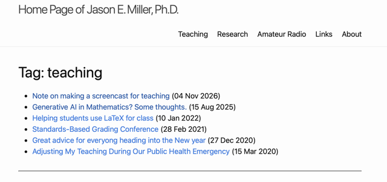

I maintain this web site to support (some of) my work as a professor, but i also want to use it to support non-work efforts.  Some things I do, like amateur radio, are at the intersection of work and non-work.  Using a work web site to write about such activities seems reasonable to me, but there are other things that should be kept separate.  For example, opinions on politics or culture.  Keeping those separate from work helps protect my employer, and helps protect me from my employer.

It's with this thought, that I did a little vibe coding this morning with ChatGPT with the goal of fixing some errors in how tagging was working and in the hope that I could use tags to segregate work-like posts away from personal posts.  This is what I learned.

## Tagging Posts

The YAML header for posts includes a field `tags:` where you can put keywords.  I then used a python script called `tag.generator.py` that would filter all the posts in `_posts/` and build an index of tags that were hyperlinked to information about other posts with the same tags.

I was having a problem.  There were tags in my index that didn't come from any post.  Not that I could find, anyway.  After exhausting what I knew to do (*e.g.*, looking at the files' YAML headers, looking for Jekyll files that relate to the tags), I turned to ChatGPT for suggestions.

After trying to chase down the origina of the phantom tags, ChatGPT steered me toward using native Jekyll methods for the tags and tag-related pages.  It suggested revisions to `_layouts/tagpage.html` and `_includes/archive.html`.

Here's the code I ended up using for each.


Here is `tagpage.html`:


```liquid
---
layout: default
---
<div class="post">
<h1>Tag: {{ page.tag }}</h1>
<ul>

  <li><a href="{{ post.url }}">{{ post.title }}</a> ({{ post.date | date_to_string }})<br>
    {{ post.description }}
  </li>

</ul>
</div>
<hr>

```


For each tag, this generates the list of posts that have that tag along with the date of the post.  Each item in the list is hyperlinked to the original post.  UHere's an example of what's produced.

[](/assets/images/screenshot-261108-tags01.png)

Here is `archive.html`:


```liquid
<h2>Archive</h2>


<p>Below is a complete list of tags used in the posts, each followed by a count of the number of times the tag is used.  Click on a tag in the list to see the titles of the associated posts.</p>


  
    {{ tag[0] | downcase }}|{{ tag[0] }}@@
  





  
  

  
    <a href="{{ '/tag/' | append: tagname | relative_url }}">
      <code class="highlighter-rouge">
        <nobr>{{ tagname }} ({{ site.tags[tagname].size }})</nobr>
      </code>
    </a>
  

```


This produces a list of all the tags on the site with each tag hyperlinked to a page like the one generated using the `tagpage.html` template, above.  THis gives visitors a very nice was to explore all the posts.  And it gives me a way of finding a post I'm searching for.

<!--

SYNTAX FOR IMAGES
* use services to create JPG and to create thumbnail that is 720px wide

[](/assets/images/filename.jpg)

LIQUID APPROACH
Recommended Liquid Filter Approach


-->

<!--

SYNTAX FOR VIDEO
* convert MOV to mp4 using VLC

<video width="480" height="320" controls="controls">
  <source src="/assets/media/filename.m4v" type="video/mp4">
</video>

-->
