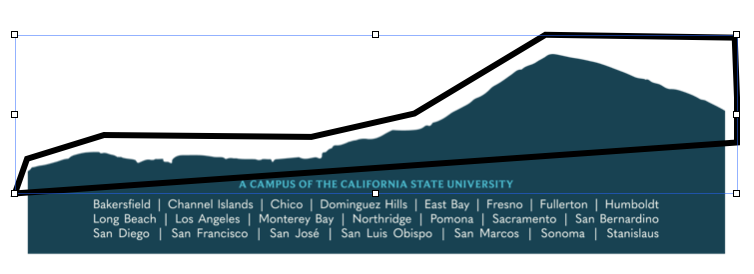

The University just changed its branding, so its letterhead changed.  Not that we're given decent electronic copies of the new letterhead.  We just get a [MS Word file](https://csuci.sharepoint.com/:w:/r/sites/BrandAssets2026/_layouts/15/Doc.aspx?sourcedoc=%7BEF990F46-5BDA-4F4B-ABA2-688817D10544%7D&file=ELH%20DAA.docx&action=default&mobileredirect=true) that has an image for the new header, an image for the new footer, and a text box between for text.  But the damn thing doesn't allow you to add a second page!  It's not a proper template suitable for work.  This doc is about my attempt to fix that for myself.

I decided to make a template in Apple Pages (version 15.4) that has the new letterhead as its first page and allows the addition of pages that have no header or footer images.  This is the way letterhead should be working.

## How to create the template in Pages

This is something that only needs to be done once.  Afterward, the template can be reused indefinitely.

To create the new template, do the following.

1. Open a new Word Processing document (as opposed to a layout document).
2. Copy the header image into the document along with the footer images.  In the **Format > Arrange** sidebar, use the **Position** fields to place the images where they belong.  The top image goes at (1in,0in), and the bottom image goes at (0in,8.11in).
3. Staying in the **Arrange** section of the **Format** menu, the **Object Placement** value of both images should be set at **Stay on Page**.  This keeps the image from showing up on subsequent pages.
4. Because the footer is an image of Satwiwah and extends up into the text column of the page, a full page of text will overlap the image and be impossible to read.  Something can be done about that.  Place a rectangle at the bottom of the page so it extends across the test column, and extends up from the bottom of the text column up to the level of the peak of Satwiwah.  The rectangle I created is 1.37in high and 6.5in wide, and is positioned at (1in, 8.31in).  This rectangle is called an *invisible object*.
5. With the rectangle selected, in the **Arrange** side menu set **Text Wrap** to be **None** using the drop-down menu.  This configures the rectangle to block text from appearing over it, effectively stopping the text from overlapping the footer image.
6. We're done with the creation step.  Now save the document using the **Save as template** item in the **File** menu.  I called my template *CSUCI Letterhead*.

This allows a person to write a multipage document whose first page is the new letterhead with text stopping before it reaches the peak of Satwiwah, and all subsequent pages are blank as they should be.

Alternatively, instead of using a rectangle as an invisible object that blocks the text from overlapping the peak of Satwiwah, one could create a shape with **Line** from the **Insert** menu.  Specifically, use the **Draw with Pen** option that lets you add points and move them arond so you can mold the top edge of the shape to reflect the contour of the mountain pictured in the footer image.

If the top of your shape has a peak, then the text will wrap to it and have a very odd looking break that creates a reading discontinuity.  It's not an acceptable look.  So I set the top right side of the shape to be horizontal.  (See the pic below.). If the peak breaks the text, then the text wraps instead of skipping ahead and creating a horizontal gap.

