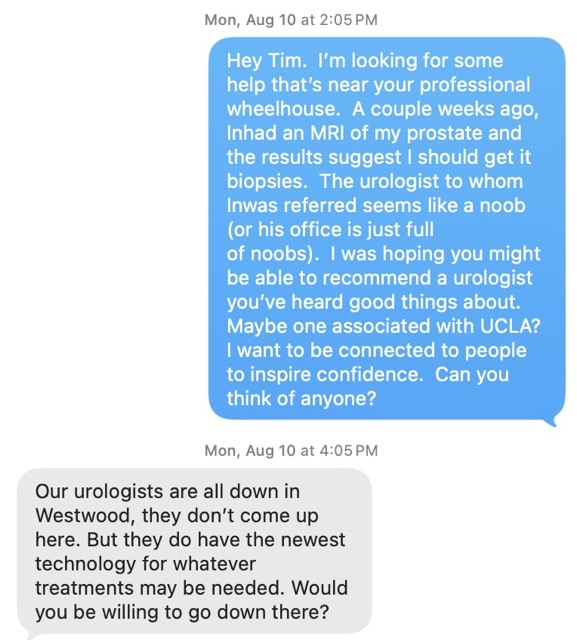

In 2009, author and journalist Jeff Jarvis began using Twitter to share his experiences as he dealt with a diagnosis of prostate cancer.  He led people on his arc through treatment and recovery.  His micro-blogging was described by some as 'radical oversharing'.  For others, his narrative revealed a medical reality for many men in the U.S.  For many (not just men), it reduced the mystery and stigma of cancer battles and recovery.

I'm might be starting a similar journey, and I'm going to write about it.

My experience will not be the same as Jeff's.  I'm not starting from the same point (the c-word is merely a possibility at this point), and my experience so far has been distinctly different.  Also, there's no audience that's already paying attention to me; in fact, I'm not sure who I'm writing for other than myself.  If others read this and get some insight navigating health and the American Healthcare System, then the time and effort I put into creating this will be worth it.

## Let's just be careful

In spring of 2026, I made a decision to take a different approach to my personal health.  Up until then, I'd been only visiting doctors by necessity.  Now, I was choosing to be proactive about some lingering health issues like high cholesterol, high blood pressure, some recurring (chronic?) body pain, and stress.  My new approach was to lean in and take advantage of modern medical technology to improve my health.  I'm lucky to have a thoughtful primary care physician (Dr. Hany Fouad at Dignity Health) who supported this pivot.

In March, I had a checkup following a standard blood test.  Dr. Fouad noted that my [PSA levels](https://www.mayoclinic.org/tests-procedures/psa-test/about/pac-20384731) were a little high and creeping up while other blood chemistry factors were edging down.  "Better be safe and look at this," he said.

I took the blood test again in April and the numbers were still a bit elevated.  After a standard digital prostate exam that seemed normal[^2], Dr. Fouad suggested I get an [MRI](https://www.mayoclinic.org/tests-procedures/prostate-mri/about/pac-20596560) done of my prostate to get a better sense of what's happening in there.  I scheduled the MRI (my first ever).  It was easy but not quick.  This was mid-July.

[^2]:  There's a stand-up joke here that I'm working on.  It has something to do with the American male's distaste for the idea of getting an anal digital exam until he actually has one and finds out it's not so bad.  And then he experiences a second kind of self-distaste for the idea that it wasn't so bad.  It still needs workshopping.
## Biopsy Salesman

Dr. Fouad sent me to consult on the MRI with a urologist, Dr. Michael Poon at Community Memorial Health.  I met with Dr. Poon on August 11th.  Because I didn't know anything about him, I was already thinking about second opinions.  

My intimate experiences with the American Healthcare System has been limited to an outpatient hernia operation, an inpatient treatment for a wound infected with MRSA, and a vasectomy done by a very colorful doctor.  I've been witness to my wife's relationship with doctors (which has been more consistent than mine), and I've watched from afar while my dad has gone through some major medical incidents including a debilitating West Nile Virus infection and three types of cancer (thyroid, prostate, and something in his chest).  He got treatment for West Nile at the Mayo Clinic in Rochester, MN, and that treatment led to the discovery of this other cancer that they also treated (by removing).  He and my mom couldn't say enough good things about their experience at Mayo.  Knowledgeable and skilled doctors, top-grade care, clear processes, all delivered with a clockwork efficiency of a fine-tuned factory.

I wanted that.  

The American Healthcare System is not built to deliver Mayo clinic quality for everyone.  The American Healthcare System is Big Business, and it's selling its wares to its customers.  Blood tests, Xrays, MRIs, biopsies, appointments with specialists.  These all have a veneer of medical magic, but they're mainly generate income for those inside the system.  If you want quality care, you have to work to find it and you must be prepared to reject a doctor if you think they are compromised by something that's not in your interest.  It's not personal.  It's your health.  So you can be brutal in the process you use to find the right doctor.

As my appointment with Dr. Poon was approaching, I racked my brain for friends and acquaintances who could give me advice on good doctors.  How could I find the best urologist in the area that's covered by my insurance?  The insurance company has a web site that will tell me who is in my network, but the site gives very little information that would help a person choose a doctor for the right reasons.   I have a friendly neighbor who is a UCLA-trained cardiologist.  I texted him on August 10th.

This primed my research pump.  He recommended two urologists he knew about.  I called the UCLA urology department and learned that neither were taking patients at the time.  Bummer.

The next day, I had my appointment with Dr. Poon.  That meeting didn't go great.  Dr. Poon had the aura of having been a frat boy, and when he learned I was a mathematics professor, he laughed and smiled as told me that he cheated in college Calculus using a roommate's girl friend's homework.   I can't remember if that was before or after he told me that the MRI showed some abnormalities (or lesions) on my prostate.  Those lesions merited a biopsy.  After he said there was a 30%-50% chance they would turn out to be cancerous, he tried to shuffle me into an appointment with his clinic for the ultrasound-guided biopsy in a couple weeks.  I demurred, saying I'd have to talk with my wife first. 

Was this me saying that I didn't know what to do about my health at that point?  No.  I didn't doubt that I'd need a biopsy.  Was this me saying I couldn't make a decision about my healthcare without my wife's input?  No.  It was me having a gut feeling that Dr. Poon, the biopsy salesman, was positioning me to open a spigot of insurance money and pour it into his clinic .  In America, health care is a business.  And I'm was about to become a valuable customer for someone.  I wonder if physicians get bonuses for lining up patients like me.

Before I even made it to my car in the parking lot, I had decided to find a different urologist.

(Fast forward to November 2026.  I'm in an exam room with my primary physician, Dr. Foud.  As I update him on my prostate journey, I share that I really don't like Dr. Poon.  "You're not the first," he replied drily.[^3])

[^3]:  Then why does Dr. Fouad refer patients to Dr. Poon?  Could it be that Dr. Poon is in the same medical organization as Dr. Fouad, and there's an expectation that Dr. Fouad refer patients to Dr. Poon for business reasons?  This is the way the American Medical System works.  So we patients need to be ever vigilant and exercise complete control over our care decisions.  *Caveat emptor.* 
